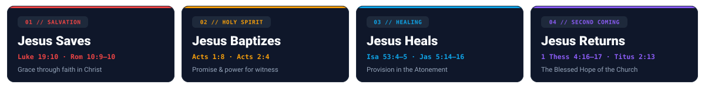
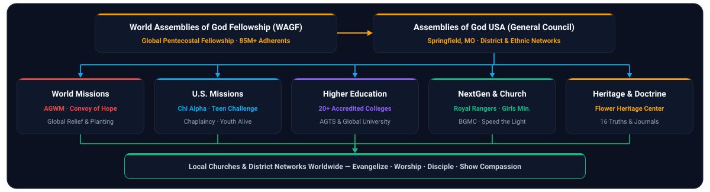

<picture>
  <source media="(prefers-color-scheme: dark)" srcset="./assets/hero-dark.svg" />
  <source media="(prefers-color-scheme: light)" srcset="./assets/hero-light.svg" />
  
</picture>

  

> **Assemblies of God (AG) · Pentecostal · Churches · Higher Education · Missions · Theology · Discipleship**
>
> A comprehensive, community-curated directory of notable Assemblies of God churches, the **16 Fundamental Truths**, official theological position papers, accredited universities and seminaries, world and domestic missions, scholarly journals, podcasts, leadership frameworks, and archival study libraries.
>
> 🌐 **Prefer instant search & category filtering?** Launch the interactive [**Awesome Assemblies of God Web Explorer**](https://jsilvalabs.github.io/Awesome-Assemblies-of-God-Church/).
>
> *Disclaimer: This Awesome List is a community-driven open-source resource and is **not an official publication or endorsement of the General Council of the Assemblies of God**. See [contributing.md](contributing.md) to suggest additions or updates.*

---

## Contents

- [The Fourfold Gospel & Ecosystem](#the-fourfold-gospel--ecosystem)
- [Churches](#churches)
- [Doctrines & Position Papers](#doctrines--position-papers)
  - [16 Fundamental Truths](#16-fundamental-truths)
  - [Official Position Papers & Statements](#official-position-papers--statements)
  - [Structure, Law & Affiliations](#structure-law--affiliations)
- [Universities & Seminaries](#universities--seminaries)
- [Ministries & Missions](#ministries--missions)
- [Scholarly Journals & Bible Studies](#scholarly-journals--bible-studies)
- [Media, Podcasts & Social Channels](#media-podcasts--social-channels)
- [Leadership & Discipleship Frameworks](#leadership-and-discipleship-frameworks)
- [Reading Lists & Media Archives](#reading-lists--media-archives)
- [Contribute & License](#contribute--license)

---

## The Fourfold Gospel & Ecosystem

<picture>
  <source media="(prefers-color-scheme: dark)" srcset="./assets/fourfold-gospel-dark.svg" />
  <source media="(prefers-color-scheme: light)" srcset="./assets/fourfold-gospel-light.svg" />
  
</picture>

 

<picture>
  <source media="(prefers-color-scheme: dark)" srcset="./assets/ecosystem-dark.svg" />
  <source media="(prefers-color-scheme: light)" srcset="./assets/ecosystem-light.svg" />
  
</picture>

---

## Churches

Explore featured flagship, historic, and digital-first Assemblies of God congregations across the United States, or search thousands of congregations near you through the [**Official AG Find-a-Church Directory**](https://ag.org/Resources/Directories/Find-a-Church).

| Church | Location | Highlights |
| :--- | :--- | :--- |
| [**Bayside Community Church**](https://mybayside.church) | Bradenton, FL | Multi-campus Gulf Coast congregation with strong small-group & next-gen discipleship |
| [**Calvary Christian Church**](https://www.calvarychristian.church) | Lynnfield, MA | Thriving multi-generational church serving families across Boston's North Shore |
| [**Dream City Church**](https://dreamcitychurch.us) | Phoenix, AZ | Historic Phoenix multi-campus ministry known for compassion outreach (Dream Center) |
| [**Faith Assembly (Faith Church)**](https://faithassembly.org) | Orlando, FL | Major Central Florida AG church with robust missions, bilingual, and family ministries |
| [**Griffin First Assembly**](https://griffinfirst.org) | Griffin, GA | Regional Georgia congregation noted for leadership training and global missions |
| [**James River Church**](https://jamesriver.church) | Springfield / Ozark, MO | Multi-site flagship known for worship production, conferences, and global relief |
| [**National Community Church**](https://national.cc) | Washington, DC | Innovative multi-site urban congregation meeting in iconic Capitol-region venues |
| [**Oaks Church**](https://oaks.church) | Red Oak (DFW), TX | Fast-growing North Texas church emphasizing multi-generational fellowship and outreach |
| [**Radiant Church**](https://radiant.church) | Kalamazoo, MI | Multi-campus Michigan congregation focused on church planting and college outreach |
| [**River Valley Church**](https://rivervalley.org) | Twin Cities, MN | Multi-site Minnesota fellowship supporting large-scale global missions and worship |
| [**Timberline Church**](https://timberlinechurch.org) | Fort Collins, CO | Front Range multi-site congregation recognized for community engagement and media |
| [**Trinity Church**](https://trinitychurch.org) | Cedar Hill (DFW), TX | Large Dallas–Fort Worth regional church with extensive missions and Christian education |

---

## Doctrines & Position Papers

### 16 Fundamental Truths

Adopted by the Assemblies of God in [The Statement of Fundamental Truths](https://ag.org/Beliefs/Statement-of-Fundamental-Truths):

| # | Fundamental Truth | Core Emphasis | Primary Scripture |
| :--: | :--- | :--- | :--- |
| **1** | **The Scriptures Inspired** | Verbally inspired Word of God & infallible rule of faith | `2 Tim 3:15–17; 2 Pet 1:21` |
| **2** | **The One True God** | Eternally self-existent "I AM" in Trinity: Father, Son, Holy Spirit | `Deut 6:4; Matt 28:19` |
| **3** | **The Deity of the Lord Jesus Christ** | Eternal Son of God, virgin birth, sinless life, miracles & atonement | `Matt 1:23; Heb 1:3` |
| **4** | **The Fall of Man** | Voluntary transgression resulting in physical & spiritual death | `Gen 1:26–31; Rom 5:12–21` |
| **5** | **The Salvation of Man** | Redemption solely through the shed blood of Jesus Christ | `Luke 24:47; Eph 2:8` |
| **6** | **The Ordinances of the Church** | Baptism in water by immersion & Holy Communion | `Matt 28:19; 1 Cor 11:26` |
| **7** | **The Baptism in the Holy Spirit** | Enduement of power for life and service subsequent to new birth | `Luke 24:49; Acts 1:8` |
| **8** | **The Initial Physical Evidence** | Speaking with other tongues as the Spirit gives utterance | `Acts 2:4; 1 Cor 12:4–10` |
| **9** | **Sanctification** | Act of separation from evil and dedication unto God | `Rom 12:1–2; 1 Thess 5:23` |
| **10** | **The Church and Its Mission** | Body of Christ called to evangelize, worship, disciple & show compassion | `Eph 1:22–23; Matt 28:19` |
| **11** | **The Ministry** | Divinely called and scripturally ordained fivefold ministry leadership | `Mark 16:15–20; Eph 4:11–13` |
| **12** | **Divine Healing** | Deliverance from sickness provided in the atonement | `Isa 53:4–5; Jas 5:14–16` |
| **13** | **The Blessed Hope** | Resurrection of those asleep in Christ and translation of believers | `1 Thess 4:16–17; Titus 2:13` |
| **14** | **The Millennial Reign of Christ** | Second coming of Christ with His saints to reign on earth 1,000 years | `Rev 19:11–14; 20:1–6` |
| **15** | **The Final Judgment** | Final judgment in which the wicked are judged and consigned to eternal punishment | `Matt 25:46; Rev 20:11–15` |
| **16** | **The New Heavens and the New Earth** | Promised new creation wherein righteousness dwells forever | `2 Pet 3:13; Rev 21–22` |

### Official Position Papers & Statements

- **General Presbytery Official Position Papers (`AG USA`):**
  - [Abstinence from Alcohol](https://ag.org/Beliefs/Position-Papers/Abstinence-from-Alcohol) · [Apostles and Prophets](https://ag.org/Beliefs/Position-Papers/Apostles-and-Prophets) · [Assurance of Salvation](https://ag.org/Beliefs/Position-Papers/Assurance-Of-Salvation)
  - [Baptism in the Holy Spirit](https://ag.org/Beliefs/Position-Papers/Baptism-in-the-Holy-Spirit) · [A Biblical Perspective on Gambling](https://ag.org/Beliefs/Position-Papers/A-Biblical-Perspective-on-Gambling) · [Doctrine of Creation](https://ag.org/Beliefs/Position-Papers/The-Doctrine-of-Creation)
  - [Church Mission and Peacemaking](https://ag.org/Beliefs/Position-Papers/Church-Mission-and-Peacemaking) · [Divine Healing](https://ag.org/Beliefs/Position-Papers/Divine-Healing) · [Divorce and Remarriage](https://ag.org/Beliefs/Position-Papers/Divorce-and-Remarriage) · [Domestic Violence](https://ag.org/Beliefs/Position-Papers/Domestic-Violence)
  - [Eternal Punishment](https://ag.org/Beliefs/Position-Papers/Final-Judgment) · [Homosexuality, Marriage, and Sexual Identity](https://ag.org/Beliefs/Position-Papers/Homosexuality-Marriage-and-Sexual-Identity) · [Inspiration, Inerrancy, and Authority of Scripture](https://ag.org/Beliefs/Position-Papers/Inspiration-Inerrancy-Authority-of-Scripture)
  - [Kingdom of God](https://ag.org/Beliefs/Position-Papers/Kingdom-of-God) · [Leadership and Governance in the Local Church](https://ag.org/Beliefs/Position-Papers/Leadership-and-Governance-in-the-Local-Church) · [Ordination: The Recognition of a Call to Ministry](https://ag.org/Beliefs/Position-Papers/Ordination---The-Recognition-of-a-Call-to-Ministry)
  - [Ministry to People With Disabilities](https://ag.org/Beliefs/Position-Papers/Persons-with-Disabilities-in-the-Ministry-of-the-Church) · [Positive Confession, The Believer And…](https://ag.org/Beliefs/Position-Papers/The-Believer-and-Positive-Confession) · [Premillennial Eschatology (2024)](https://ag.org/Beliefs/Position-Papers/Premillennial-Eschatology)
  - [Racism, a Biblical Response](https://ag.org/Beliefs/Position-Papers/Racism-a-Biblical-Response) · [Rapture of the Church](https://ag.org/Beliefs/Position-Papers/The-Rapture-of-the-Church) · [Reformed Theology, A Response to…](https://ag.org/Beliefs/Position-Papers/Reformed-Theology-Response-of-the-AG-Position-Paper)
  - [Revival and Spiritual Renewal (2024)](https://ag.org/Beliefs/Position-Papers/Revival-and-Spiritual-Renewal) · [Sanctity of Human Life — Abortion & Reproductive Issues](https://ag.org/Beliefs/Position-Papers/Abortion-Sanctity-of-Human-Life) · [Sanctity of Human Life — Suicide & Euthanasia](https://ag.org/Beliefs/Position-Papers/Suicide-Assisted-Suicide-Official-AG-Position-Paper)
  - [Spiritual Warfare and the Believer](https://ag.org/Beliefs/Position-Papers/Spiritual-Warfare-and-the-Believer) · [The Role of Women in Ministry](https://ag.org/Beliefs/Position-Papers/The-Role-of-Women-in-Ministry) · [Transgenderism, Transsexuality, and Gender Identity](https://ag.org/Beliefs/Position-Papers/Transgenderism-Transsexuality-and-Gender-Identity) · [Worship in the Bible](https://ag.org/Beliefs/Position-Papers/Worship-in-the-Bible)
- **World Assemblies of God Fellowship (WAGF) Theological Commission Papers:**
  - [Revised Pentecostal Theology of Compassion](https://worldagfellowship.org/-/media/World-AG-Fellowship/Bylaws-Membership-Papers/PentecostalTheologyofCompassionWAGFPositionPaperFinalRevisedVersionfrom1May2012withnewcover.pdf)
  - [Essential Nature of the Church as the Missional People of God](https://worldagfellowship.org/-/media/World-AG-Fellowship/Bylaws-Membership-Papers/4eFinalVersionEssentialNatureofChurchRevCdnTheoComm1.pdf)
  - [Redefinition of Marriage and Human Sexuality](https://worldagfellowship.org/-/media/World-AG-Fellowship/Bylaws-Membership-Papers/Redefinition-of-Marriage-and-Human-Sexuality-WAGF-Website-Version.pdf)
  - [Hyper-Grace Issue Position Paper](https://worldagfellowship.org/-/media/World-AG-Fellowship/Bylaws-Membership-Papers/Hyper-Grace-Issue-Position-Paper-Draft-US-Letter-Format.pdf)
- **Assemblies of God Official Statements & Royal Rangers Standards:**
  - [Statement Regarding Chi Alpha](https://ag.org/xastatement) · [Statement Against Antisemitism](https://news.ag.org/en/articles/news/2022/11/statement-against-antisemitism) · [Resolution on Racism](https://news.ag.org/en/articles/news/2010/02/resolution-on-racism)
  - [Response Regarding NAE Immigration Resolution](https://news.ag.org/en/articles/news/2009/10/response%20regarding%20nae%20immigration%20resolution) · [Statement on Revival](https://news.ag.org/en/articles/news/2008/08/statement%20on%20revival) · [Royal Rangers Standards](https://royalrangers.com/policies/standards)

### Structure, Law & Affiliations

- **Governance:** [Assemblies of God Constitution and Bylaws](https://ag.org/About/About-the-AG/Constitution-and-Bylaws) · [AG Organizational Structure](https://ag.org/About/About-the-AG/Structure) · [Local Church Bylaws Template](https://ag.org/About/Leadership%20Team/General%20Secretary#ByLaws)
- **Legal & Pastoral Policies:** [Church, Law & Tax (Richard R. Hammar)](https://store.churchlawandtax.com/authors/richard-r-hammar/) · [North Texas District Sabbatical Policy](https://www.northtexas.ag/sabbath---sabbatical) (*Study Leave, Rest & Spiritual Renewal Leave, Special Project Leave*)
- **Global Affiliations:** [National Association of Evangelicals (NAE) · PCCNA · Pentecostal World Fellowship (PWF) · World Assemblies of God Fellowship (WAGF)](https://ag.org/About/About-the-AG/Affiliations)

---

## Universities & Seminaries

Accredited Bible colleges, Christian liberal arts universities, distance-learning institutions, and seminaries affiliated with the [**AG Alliance for Higher Education**](https://ag.org/Ministries/Education) ([colleges.ag.org](https://colleges.ag.org/)):

| Institution | Type / Focus | Link |
| :--- | :--- | :--- |
| **Ascent College** | Ministry & Leadership Degrees (Online) | [ascent.edu](https://www.ascent.edu) |
| **Assemblies of God Theological Seminary (AGTS)** | Graduate Seminary of Evangel University (Springfield, MO) | [evangel.edu/seminary](https://www.evangel.edu/seminary/) |
| **Bridges Christian College** | Christian Higher Education (Metairie, LA) | [bcc.edu](https://www.bcc.edu) |
| **California Theological Seminary (AGCTS)** | Multilingual Ministerial & Theological Training | [agcts.com](https://www.agcts.com) |
| **Caribbean Theological College** | Accredited Theological College (Bayamón, PR) | [ctcad.org](https://ctcad.org/) |
| **Center for Holy Lands Studies** | Biblical Archaeology & Field Study Tours | [thechls.org](https://thechls.org/) |
| **Christ Mission College** | Bilingual Ministry Education (San Antonio, TX) | [cmctx.edu](https://www.cmctx.edu/) |
| **Evangel University** | Comprehensive AG Christian University (Springfield, MO) | [evangel.edu](https://www.evangel.edu/) |
| **Global University** | Worldwide Distance Learning & Berean School of the Bible | [globaluniversity.edu](https://www.globaluniversity.edu/) |
| **Korean Assemblies of God Theological School of New York** | Korean-Language Theological Training (New York, NY) | [colleges.ag.org](https://colleges.ag.org/) |
| **LABI College (Latin American Bible Institute)** | Hispanic Pastoral & Ministry College (La Puente, CA) | [labi.edu](https://www.labi.edu/) |
| **Lumbee River Christian College** | Ministerial & Theological Training (Shannon, NC) | [lumbeeriver.edu](https://www.lumbeeriver.edu/) |
| **Nelson American Indian College** | Native American Christian Higher Education (Phoenix, AZ) | [aicag.edu](https://www.aicag.edu/) |
| **Nelson University** *(formerly SAGU)* | Comprehensive AG University (Waxahachie, TX) | [nelson.edu](https://www.nelson.edu/) |
| **North Central University** | Urban Christian University (Minneapolis, MN) | [northcentral.edu](https://www.northcentral.edu/) |
| **Northpoint Bible College & Seminary** | Pentecostal Bible College & Graduate Seminary (Haverhill, MA) | [northpoint.edu](https://www.northpoint.edu/) |
| **Northwest University** | Christian Liberal Arts & Nursing University (Kirkland, WA) | [northwestu.edu](https://www.northwestu.edu/) |
| **Southeastern University** | Fast-Growing AG Research & Extension University (Lakeland, FL) | [seu.edu](https://www.seu.edu) |
| **Spanish Eastern Bible College** | Northeast Hispanic Theological Training | [sededucation.org](https://www.sededucation.org/) |
| **Trinity Bible College & Graduate School** | Upper Midwest Bible College & Seminary (Ellendale, ND) | [trinitybiblecollege.edu](https://trinitybiblecollege.edu/) |
| **University of Valley Forge** | Mid-Atlantic Christian University (Phoenixville, PA) | [valleyforge.edu](https://www.valleyforge.edu/) |
| **Vanguard University** | Christian Comprehensive University (Costa Mesa, CA) | [vanguard.edu](https://www.vanguard.edu/) |
| **ACTS (Association of Christian Teachers & Schools)** | Pre-K–12 Christian School Accreditation Network | [actsschools.org](https://www.actsschools.org/) |

---

## Ministries & Missions

### Global & U.S. Missions
- **World Missions & Humanitarian Relief:** [AG World Missions (AGWM)](https://agwm.org) · [Convoy of Hope](https://convoyofhope.org/) · [Convoy Women](https://convoyofhope.org/convoy-women/)
- **US Missions Core Departments:**
  - [Adult & Teen Challenge](https://teenchallengeusa.org/) — Residential addiction recovery and discipleship
  - [Chaplaincy Ministries](https://chaplaincy.ag.org/) — Military, hospital, prison, and marketplace chaplains
  - [Chi Alpha Campus Ministries](https://chialpha.com/) — University student discipleship fellowships
  - [Church Mobilization](https://churchmobilization.ag.org/) — Volunteer construction (MAPS) and local mission teams
  - [Intercultural Ministries](https://intercultural.ag.org/) — Ethnic, refugee, disability, and specialized outreach
  - [Youth Alive](https://youth.ag.org/YouthAlive) — Student-led campus evangelism

### NextGen, Leaders & Specialized Ministries
- **Youth & Children:** [AG Youth Ministries](https://ag.org/Ministries/Youth) *(Fine Arts, Speed the Light, Teen Bible Quiz, AIM)* · [AG Children's Ministry](https://ag.org/Ministries/Children) *(BGMC, Compact Family Services, Faith Case, Girls Ministries, Junior Bible Quiz, Radiant Life, Royal Rangers, Tru Fire, Vida Nueva)*
- **Adult, Family & Church Leaders:** [Adult and Family Ministries](https://ag.org/Ministries/Adult-and-Family) · [Leaders and Ministers](https://ag.org/Ministries/Leaders-and-Ministers) *(Church Multiplication Network, Acts 2 Journey, Influence Music, Legacy Transition Group)* · [Network of Women Ministers](https://www.womenministers.ag.org/) · [The Institute for Ministerial Wholeness](https://www.imwholeness.org/)
- **Compassion, Counseling & Care Directory:**
  - *Abuse & Addiction Recovery:* [Beyond Survival Ministries](https://www.beyondsurvivalministries.org/) · [Project Ignite Light](https://ignitelight.org/) · [Pure Life Ministries](https://www.purelifeministries.org/)
  - *Abortion Recovery & Adoption:* [SAVEONE](https://www.saveone.org/) · [Compact Family Services](https://compact.family/)
  - *Counseling & Domestic Violence:* [Emerge Ministries](https://www.emerge.org/) · [God's Transforming Grace](https://godstransforminggrace.com/)
  - *Human Trafficking Rescue:* [Global Center for Women and Justice](https://www.gcwj.org/) · [Free International](https://www.freeinternational.org/) · [Project Rescue](https://www.projectrescue.com/) · [Protect Me Project](https://www.protectmeproject.org/)
  - *Marriage & Family Care:* [AG Marriage Encounter](https://agme.org/) · [Teaming Life](http://teaminglife.com/) · [CompassionLink Disability Ministry](https://www.compassionlink.org/) · [Rural Compassion](https://www.ruralcompassion.org/)
  - *Specialized Care & Outreach:* [Linda Seiler](https://lindaseiler.com) · [Restory Ministries](https://restoryministries.org/) · [Joe Dallas](https://joedallas.com) · [Say Hello (Ministry to Muslim Women)](https://sayhelloinfo.com/) · [Widows Link](https://widowslink.org/) · [Ministry to Single Moms](http://www.loisbreit.com/)

---

## Scholarly Journals & Bible Studies

- **Historical & Archival Heritage:** [Flower Pentecostal Heritage Center (`ifphc.org`)](https://ifphc.org/) — World's largest archive of Pentecostal history, *Pentecostal Evangel* issues, photos, and audio
- **Peer-Reviewed Journals:**
  - [Encounter: Journal for Pentecostal Ministry (AGTS)](https://www.evangel.edu/seminary/student-resources/encounter-journal-for-pentecostal-ministry/)
  - [International Journal of Pentecostal Missiology (AGTS)](https://www.evangel.edu/seminary/student-resources/ijpm/)
  - [Journal of Sustainable Ministry (Southeastern University)](https://seu.edu/academics/bcmt/journal-of-sustainable-ministry-article-submission/)
- **Bible Study & Curriculum Platforms:**
  - [Bible Engagement Project](https://bibleengagementproject.com/) — Free small-group & family Scripture engagement curriculum
  - [My Healthy Church / Radiant Life](https://myhealthychurch.com/store/startcat.cfm?cat=mSUNSMALL) — Official AG publishing & discipleship curriculum
  - [NCN Bible Studies](https://agncn.org/bible-studies-curriculum) — Structured biblical curriculum resources
  - [TrustBible](https://trustbible.org/) — Free citation-backed Bible Q&A platform linking every answer directly to primary Scriptures (KJV & CUV; CC-BY-4.0 dataset)

---

## Media, Podcasts & Social Channels

- **Podcasts:** [AG News Podcast](https://ag.org/Podcast/AG-News-Podcast) · [Church Multiplication Network Podcast](https://muckrack.com/podcast/cmn-leadership-podcast/) · [Influence Magazine Podcast](https://influencemagazine.com/en/podcast) · [Ranger Podcast](https://royalrangers.com/podcast) · [Shades of Understanding (Chi Alpha)](https://pod.co/shades-of-understanding) · [Your Day Podcast](https://ag.org/Podcast/Your-Day-Podcast) · [Local AG Churches Podcast Feed](https://player.fm/podcasts/Assembly-Of-God)
- **Magazines, News & Newsletters:** [AG News](https://news.ag.org/) · [Influence Magazine](https://influencemagazine.com/) · [Worldview (AGWM)](https://agwm.org/en/worldview/) · [360 Spotlight (Light for the Lost)](https://lftl.ag.org/360-Spotlight) · [Primeline](https://sam.ag.org/) · [Rangers NOW](https://royalrangers.com/rangersnow) · [The Institute of Ministerial Wholeness Blog](https://www.imwholeness.org/blog) · [Harris Speaks: Unmasking Bias (LinkedIn)](https://www.linkedin.com/newsletters/7248816858575826945) · [Enrichment Journal Legacy](https://enrichmentjournal.ag.org/)
- **YouTube Channels:** [Assemblies of God USA](https://www.youtube.com/@AG_USA) · [AGWM](https://www.youtube.com/@AssembliesofGodWorldMissions) · [Bible Engagement Project](https://www.youtube.com/@BibleEngagementProject) · [Center for Holy Lands Studies](https://www.youtube.com/@HolyLandsStudies) · [Church Law & Tax](https://www.youtube.com/@ChurchLawAndTax) · [Church Multiplication Network](https://www.youtube.com/@ChurchMultiplicationNetwork) · [AG Kidmin](https://www.youtube.com/@AGKidmin) · [AG Youth](https://www.youtube.com/@AGYouth) · [My Healthy Church](https://www.youtube.com/@MyHealthyChurch) · [Network of Women Ministers](https://www.youtube.com/c/networkofwomenministers) · [Proyecto Compromiso Bíblico](https://www.youtube.com/c/ProyectoCompromisoB%C3%ADblico) · [360 Man Podcast](https://www.youtube.com/@360manpodcast9)
- **Instagram — National:** [AG USA](https://www.instagram.com/ag_usa/) · [AG BGMC](https://www.instagram.com/agbgmc/) · [AG Kidmin](https://www.instagram.com/agkidmin/) · [AG Women](https://www.instagram.com/ag_women/) · [AG Youth](https://www.instagram.com/ag_youth/) · [Bible Engagement Project](https://www.instagram.com/bibleengagementproject/) · [Called AG](https://www.instagram.com/called.ag/) · [Chi Alpha USA](https://www.instagram.com/chialphausa/) · [Church Multiplication Network](https://www.instagram.com/cmnetwork/) · [Convoy of Hope](https://www.instagram.com/convoyofhope/) · [Holy Lands Studies](https://www.instagram.com/holylandsstudies/) · [Speed The Light](https://www.instagram.com/agspeedthelight/) · [Teen Challenge USA](https://www.instagram.com/teenchallengeusa/) · [US Missions AG](https://www.instagram.com/usmissionsag/)
- **Instagram — Districts:** [North Texas](https://www.instagram.com/northtexas_ag/) ([Kids](https://www.instagram.com/ntxkids/)) · [South Texas](https://www.instagram.com/southtexasag/) ([Men](https://www.instagram.com/stxdmensministry/)) · [SoCal](https://www.instagram.com/socalnetwork/) ([Youth](https://www.instagram.com/socalyouth/)) · [North Carolina](https://www.instagram.com/ncag_/) ([Fine Arts](https://www.instagram.com/ncagfinearts/)) · [Georgia](https://www.instagram.com/georgiaag/) ([Youth](https://www.instagram.com/gadistrictyouth/)) · [Ohio](https://www.instagram.com/ohioministrynetwork/) ([Students](https://www.instagram.com/ohiostudents/)) · [PennDel Youth](https://www.instagram.com/penndelyouth/) · [Iowa](https://www.instagram.com/iowaministrynetwork/) · [Illinois](https://www.instagram.com/ilagdistrict/) · [Arkansas Youth](https://www.instagram.com/arstudents/) · [Alaska Youth](https://www.instagram.com/agkstudents/) · [Michigan](https://www.instagram.com/michiganag/)

---

## Leadership and Discipleship Frameworks

| Ministry / Body | Framework Name | Core Pillars / Elements | Reference |
| :--- | :--- | :--- | :--- |
| **Assemblies of God** | 4-Fold Mission | Evangelize the lost · Worship God · Disciple believers · Show compassion | [ag.org/Mission](https://ag.org/About/About-the-AG/Mission) |
| **AG Discipleship** | 7 Dimensions of a Spirit-Filled Disciple | Bible · Holy Spirit · Mission · Prayer · Worship · Service · Generosity | [discipleship.ag.org](https://discipleship.ag.org/7-Dimensions) |
| **Chi Alpha** | 5-Fold Approach & Core Values | Prayer · Worship · Fellowship · Discipleship · Mission \| Community, Creativity, Diversity, Excellence, Integrity, Servant-Leadership | [chialpha.com](https://chialpha.com/about/our-story/) |
| **AG Men's Ministry** | 4 Dimensions of Biblical Manhood | Vision · Identity · Relationships · Purpose | [men.ag.org](https://men.ag.org/Free-Resources) |
| **Radiant Life** | Curriculum Philosophy | Pentecostal · Systematic · Transformative · Adaptable | [Scope & Sequence PDF](https://myhealthychurch.com/store/Item_Data/downloads/RL_Scope_Sequence_21_23.pdf) |
| **Royal Rangers** | 8 Blue / 4 Gold / 4 Red / 7 Experiences & Methods | *Code:* Alert, Clean, Honest, Courageous, Loyal, Courteous, Obedient, Spiritual · *Domains:* Mental, Physical, Spiritual, Social · *Beliefs:* Salvation, Baptism in the Holy Spirit, Healing, Second Coming · *Experiences:* Connect, Do, Grow, Learn, Belong, Lead, Serve · *Methods:* Activities, Identity, Achievement, Discipleship, Leadership, Service | [royalrangers.com](https://royalrangers.com/about) |
| **Network of Women Ministers** | 4 Pillars & Values | Foster Community · Theological Awareness · Leadership Development · Unity \| Honor, Authenticity, Forgiveness, Hope | [womenministers.ag.org](https://www.womenministers.ag.org/about-nwm) |

---

## Reading Lists & Media Archives

<strong>1. Core Doctrines Reading, Sermon & Media Archives (AG Official Resources)</strong>

Primary hub: [AG Core Doctrines Resource Library](https://ag.org/Beliefs/Our-Core-Doctrines/Resources) · [Salvation](https://ag.org/Beliefs/Our-Core-Doctrines/Salvation) · [Divine Healing](https://ag.org/Beliefs/Our-Core-Doctrines/Divine-Healing) · [Baptism in the Holy Spirit](https://ag.org/Beliefs/Our-Core-Doctrines/Baptism-in-the-Holy-Spirit) · [Second Coming](https://ag.org/Beliefs/Our-Core-Doctrines/Second-Coming)

- **Salvation — Foundational Books & Articles:**
  - *Knowing the Doctrines of the Bible* (Myer Pearlman) · *Bible Doctrines: A Pentecostal Perspective* (William Menzies & Stanley M. Horton) · *Now What? Salvation* (Ralph W. Harris) · *The Life of Faith* (Mrs. C. Nuzum)
  - Articles: *Defining Truths of the AG: Salvation* (Thomas E. Trask), *Let Love Live* (Dary Northrop), *A Theology of Evangelism* (Robert E. Coleman), *Making Your Invitation Effective* (Sam Farina), *Lost Urgency* (George O. Wood), *How Can I Be Saved?* (Robert Cunningham), *Soap, Soup and Salvation* (Bill Allegacoon), *How Much Do I Have To Understand To Be Saved?* (C. M. Ward), *Are You Trusting in a False Hope?* (Ernest S. Williams)
  - Sermons & MP3s: *Our Indescribable Salvation* & *The Beginning of the Walk* (George O. Wood), *Christianity 101* & *Manasseh's Reversal* (James T. Bradford), *Jesus as Savior*, *Working Out Our Salvation*, *Five Objections to Jesus*, plus FPHC archive recordings.
- **Divine Healing — Books, Articles & Audio:**
  - *Health and Healing* (Lilian B. Yeomans)
  - Articles: *Healing and Atonement* (Anthony D. Palma), *The Gift of Gifts of Healings* (Thomas L. Holdcroft), *Defining Truths of the AG: Divine Healing* (Thomas E. Trask), *Bioethics and Ministry* (Christina M. H. Powell), *When a Child Dies* & *Surviving the Loss of a Spouse* (Richard D. Dobbins), *Effective Hospital Visitation* (Emmanuel L. William), *Domestic Violence Response* (Grant L. Martin), *Ministering to Children with Disabilities* (Julie Horner), *"Innocence Lost"* (Marnie C. Ferree)
  - Video Testimonies & Media: *When Everything Changes* (James T. Bradford), *Healing and Its Results* & *A Second Chance on Life* (George O. Wood), plus video testimony series.
- **Baptism in the Holy Spirit — Books, Articles & Series:**
  - *Baptism in the Holy Spirit* (Anthony D. Palma) · *Living in the Spirit* (George O. Wood) · *The Spirit Himself* (Ralph M. Riggs) · *When the Spirit Speaks* (Warren D. Bullock) · *Acts Today* (Ralph W. Harris) · *What the Bible Says About the Holy Spirit* (Stanley M. Horton)
  - Articles: *The Spirit Giveth Life* (Richard L. Dresselhaus), *Pentecostal Hermeneutics I & II* (Gordon L. Anderson), *Pentecostal Experience and Hermeneutics* & *The Holy Spirit in Luke-Acts* (Roger Stronstad), *The Nuts and Bolts of Ministering Spirit Baptism Parts 1–6* (Tim Enloe), *Not by Might nor by Power* (Stanley M. Horton), Fruit of the Spirit series (Gary B. McGee, Morris O. William, Dorothea J. Lotter, James D. Hernando, Stanley M. Horton, Paul A. Lee, Victor R. Ostrom), *Speaking in Tongues* (A. Reuben Hartwick, Benny C. Aker, Jon Ruthven, Melvin Ho, Gary Grogan)
  - Video & Discussions: *The Holy Spirit* (Doug Clay), *The Holy Spirit at Home* (Doug Clay & Tim Enloe), *Meaning of Pentecost* & *Discussion on Pentecost* (AG Executive Leadership Team).
- **The Second Coming — Books, Articles & Audio:**
  - *Our Destiny: Biblical Teaching on the Last Things* (Stanley M. Horton) · *Systematic Theology* (Stanley M. Horton)
  - Articles: *The Second Coming of Christ* (Thomas E. Trask), *What Does the Future Hold?* (Ken Horn), *I Believe in the Pre-Tribulation Rapture* (Stanley M. Horton), *Has the Rapture Been Called Off?* (Dan Betzer), *Do We Really Believe?* (W. E. Nunnally), *Rapture Requirements* (O. Eugene Valle), *Why Don't We Talk About It?* (Michael P. Horban)
  - Sermons & MP3s: *Behold the Lamb* & *Did You Come?* (George O. Wood), *Second Coming* (Charles E. Crank), *Jesus the Coming King*, *The Judgment Seat*.

<strong>2. Chi Alpha 25 Essential Christian Books & Devotional Reading List</strong>

Source: [Chi Alpha Resources](https://chialpha.com/resources/#category=good-reads)

- **Core Chi Alpha Reads:** *Real Devotion*, *40 Days of Decrease*, *Ready, Set, Rest*, *The Historical Validity of the Resurrection of Jesus Christ from the Dead*, *The Inside-Out Kingdom*
- **25 Essential Christian Classics:**
  - *Pursuit of God* & *Knowledge of the Holy* — A. W. Tozer
  - *Christ of the Indian Road*, *Christ and Human Suffering*, & *The Unshakable Kingdom* — E. Stanley Jones
  - *The Practice of the Presence of God* — Brother Lawrence · *Humility* — Andrew Murray · *The Greatest Thing in the World* — Henry Drummond
  - *Mere Christianity*, *The Weight of Glory*, & *The Screwtape Letters* — C. S. Lewis
  - *True Spirituality* — Francis Schaeffer · *The Normal Christian Life* — Watchman Nee · *The Cross and the Switchblade* — David Wilkerson
  - *Bruchko* — Bruce Olson · *Peace Child* — Don Richardson · *Through Gates of Splendor* — Elisabeth Elliot
  - *Counterfeit Gods* & *The Reason for God* — Timothy Keller · *What's So Amazing About Grace?* — Philip Yancey
  - *Surprised by Hope* — N. T. Wright · *The God They Never Knew* — George Otis Jr. · *Discovering the Character of God* — George MacDonald
  - *The Live Dead Journal* — Live Dead Team · *Radical* — David Platt

<strong>3. Royal Rangers & District Pastoral Reading Lists + Ministerial Portfolio Template</strong>

- **Royal Rangers Leader Reading List ([royalrangers.com/training/staff](https://royalrangers.com/training/staff)):**
  - *Manhood:* *Maximized Manhood*, *Manhood 101*, & *Unique Woman* (Edwin Louis Cole) · *Raising a Modern-Day Knight* (Robert Lewis) · *Wild at Heart*, *Fathered by God*, & *Epic* (John Eldredge) · *Do Hard Things* (Alex & Brett Harris) · *Living in the Spirit* (George O. Wood) · *A Guy's Journey to Manhood* (Doug Marsh) · *Teaching Your Children the Truth About Sex* (Jim Dobbins)
  - *Leadership:* *Habitudes 1–4* & *Generation iY* (Tim Elmore) · *Spiritual Leadership* (J. Oswald Sanders) · *Developing the Leader Within You* (John Maxwell) · *The Five Dysfunctions of a Team*, *Death by Meeting*, & *Silos, Politics, and Turf Wars* (Patrick Lencioni) · *Good to Great* & *How the Mighty Fall* (Jim Collins) · *Leading Change* (John P. Kotter) · *Leading at a Higher Level* (Ken Blanchard) · *The Mentor Leader* (Tony Dungy) · *Next Generation Leader* (Andy Stanley) · *The Circle Maker* (Mark Batterson)
- **District Clergy Renewal & Marriage Reading Lists:**
  - **North Texas District ([Better Marriage 365](https://northtexas.ag/better-marriage-365/) & [Sabbatical & Sabbath](https://northtexas.ag/sabbatical-sabbath/)):** *Never Settle For Good Enough* (Kendall & Starla Bridges), *Clergy Renewal* (Bullock & Bruesehoff), *Ordering Your Private World* (Gordon MacDonald), *Leading on Empty* (Wayne Cordeiro), *Refresh, Renew, Revive* (H. B. London Jr.), *The Rest of God* (Mark Buchanan), *The DNA of Relationships* (Gary Smalley), *Inside Out* (Larry Crabb), *24/6* (Matthew Sleeth), *Sacred Slow* (Alicia Chole), *The Divine Conspiracy* (Dallas Willard)
  - **Ohio Ministry Network ([Sabbatical Handbook PDF](https://irp.cdn-website.com/6c57dff6/files/uploaded/Sabbatical-Handbook-Ohio.pdf)):** Includes *Sabbath* (Wayne Muller), *Invitation to Solitude and Silence* (Ruth Haley Barton), *Deepening Your Ministry Through Prayer and Personal Growth* (Eugene Peterson), *Daily Life in the Time of Jesus* (Henri Daniel-Rops), *Traveling Light* (Max Lucado), *One Size Doesn't Fit All* (Gary L. McIntosh)
- **Ministerial Portfolio:**
  - [Ministerial Portfolio Template (Google Doc)](https://docs.google.com/document/d/1-2EYcx2ZdXmQnqvznVjLLIfT5d4Vb4O8hq7nVEsuOvw/edit?usp=sharing)

---

## Contribute & License

Contributions are warmly welcomed — see [contributing.md](contributing.md) and our [Code of Conduct](CODE_OF_CONDUCT.md).

To the extent possible under law, the maintainers have waived all copyright and related rights to this list under [**CC0 1.0 Universal**](LICENSE).